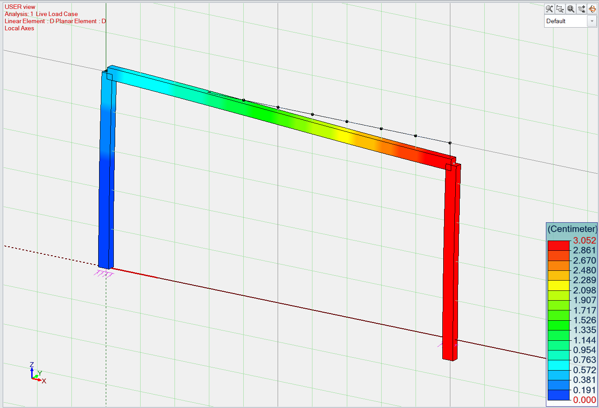
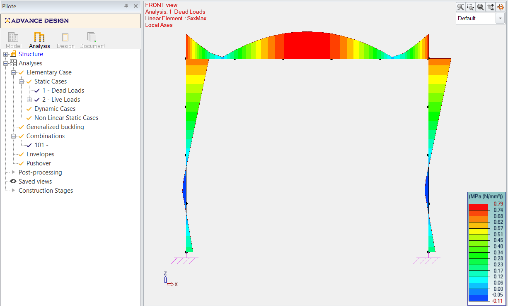
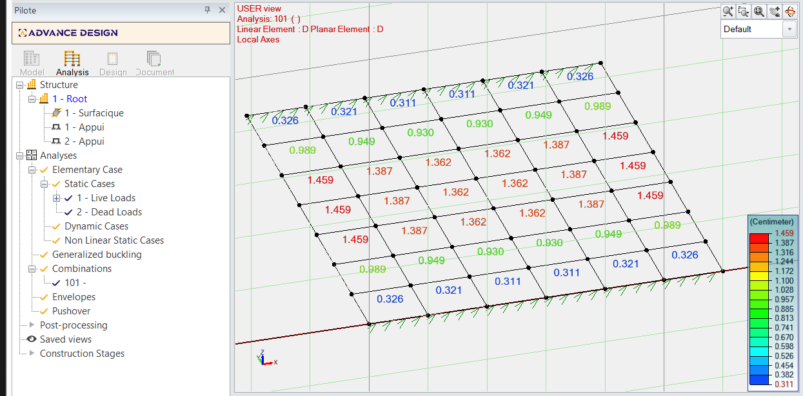
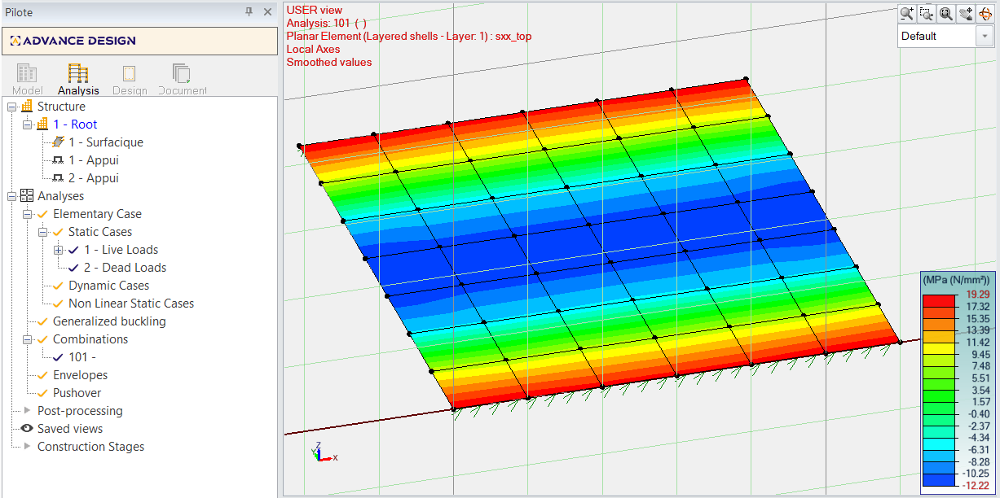
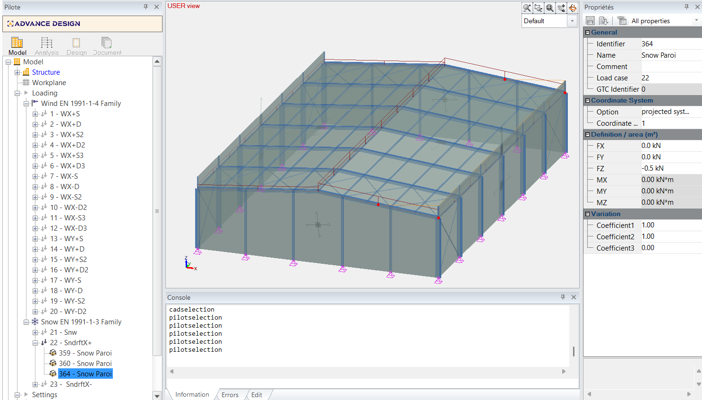
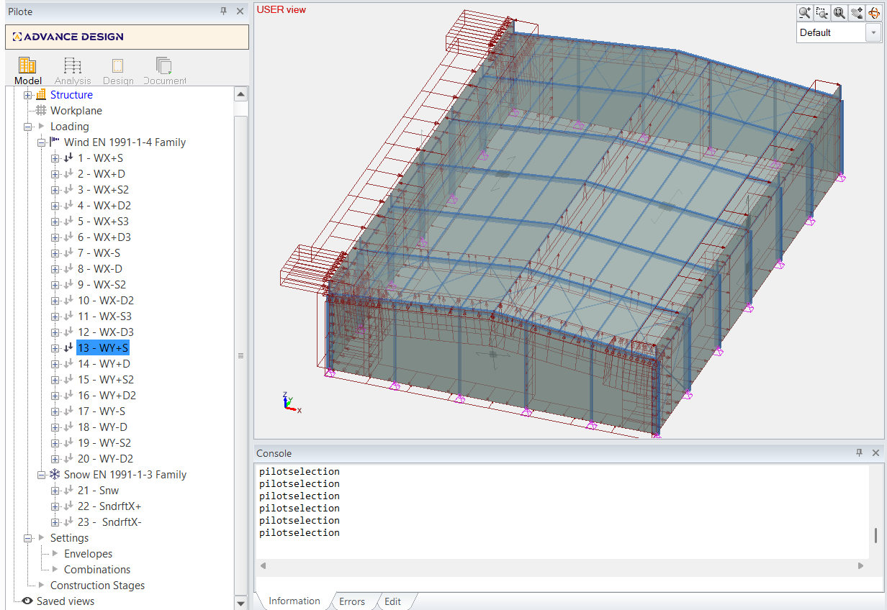
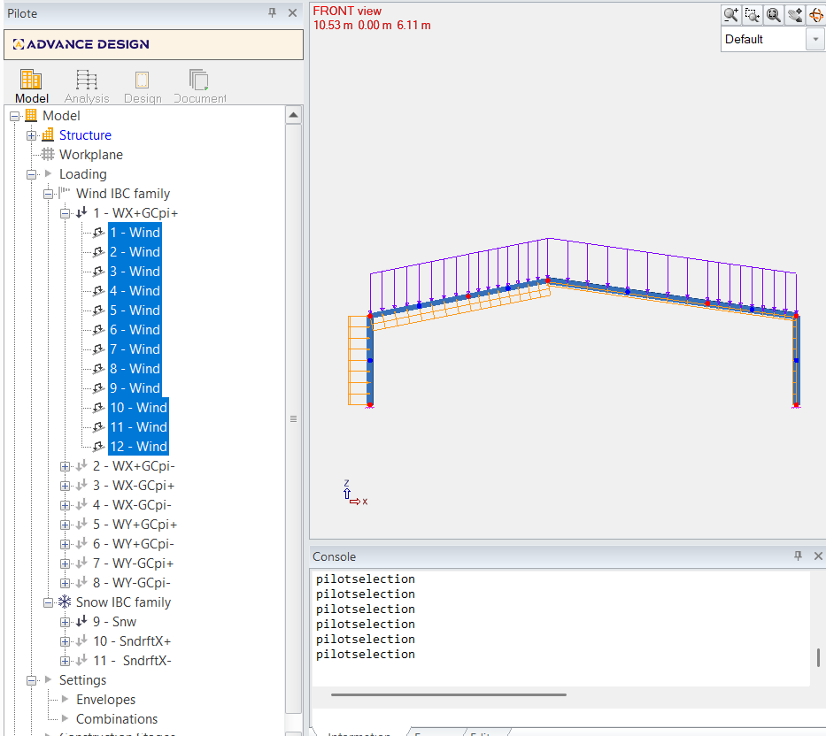

# Test.API.Client — Advance Design API Sample

A minimal **C# .NET 8 console application** showing how to drive [Advance Design](https://www.graitec.com/advance-design/) programmatically through its HTTP API.

The samples creates strucutrees in new models, call climatic loads autogeneration, creates analysis and retrives results — all without opening the Advance Design UI.

---

## Available Samples

The project includes several samples demonstrating different API capabilities. Select a sample from the menu when you run the application.

### 1. Analysis results: 4-column slab support Fz verification (Europe, 1% tol)

**File:** `PortalFrame4ColumnsSlabSupportFzVerification.cs`

Creates a Europe-localized model with 4 columns (C25/30, R20*30, 5m height), a 10m × 11m planar slab (0.20m thick) at Z=5m, 4 rigid point supports at column bases, a live load family with one planar load (Fz=-30 kN/m²), and a dead load family. Runs analysis and verifies that the sum of support Fz reactions on the live load case matches the applied slab load (Fz × area) within 1% tolerance.


### 2. Analysis results: Imposed displacement structure with result verification

**File:** `ImposedDisplacementStructureWithResults.cs`

Creates a 3-element portal frame (2 columns + 1 beam) with an imposed displacement of -3cm DZ at one support. Runs linear analysis and verifies that the displacement on the column at the imposed location is ~3cm.



### 3. Analysis results: Portal frame 3 elements analysis verification (5% tol)

**File:** `PortalFrame3ElementsAnalysisVerification.cs`

Creates a portal frame with 3 linear elements (C25/30, R20/30), 2 rigid supports, dead and live load families with punctual loads. Runs analysis with ULS combination and verifies support reaction forces, beam force diagrams (Fz, My), displacement (Dz), and stress (SxxMax) within 5% tolerance.




### 4. Analysis results: Slab with rigid linear supports, analysis and all results on slab

**File:** `PlanarSlabRigidLinearSupportsFrance.cs`

Creates a planar shell slab (0.15m thick, 42m²) with 2 rigid linear supports, a live load case with planar load (Fz=-12 kN/m²), and a dead load case. Runs analysis with ULS combination and displays all results (Displacement, Forces, Stresses) for the planar element.




### 5. Climatic: 3D building with wind (EN 1991-1-4) and snow (EN 1991-1-3) auto generation (France)

**File:** `WindSnow3DBuildingAutoGeneration.cs`

Creates a 3D building structure (columns + slabs forming a hall) with France localization. Sets up wind (EN 1991-1-4) and snow (EN 1991-1-3) load case families and triggers automatic climatic load generation according to Eurocode norms.




### 6. Climatic: Portal 2D Structure and IBC (ASCE 7-22) Climatic Generation

**File:** `Portal2DStructureAndClimaticGeneration.cs`

Creates a 2D steel portal frame with IBC (ASCE 7-22) wind and snow load case families. Demonstrates automatic climatic load generation for US building codes with multiple wind directions and snow load cases.




### 7. Climatic: Portal 2D Structure and IBC (ASCE 7-22) Climatic Generation (multiple roof elements)

**File:** `Portal2DStructureAndClimaticGeneration.cs`

Extended version of the previous sample with multiple roof elements to demonstrate climatic load distribution across complex roof geometries.

### 8. Intentional error testing: Structure with intentional material error

**File:** `StructureWithIntentionalMaterialError.cs`

Demonstrates error handling by intentionally creating a structure with an invalid material reference, showing how to catch and handle API errors gracefully.

### 9. Properties setting and model management: Custom properties set and verification after reopen

**File:** `CustomPropertiesVerificationOnReopen.cs`

Creates a structure, sets custom properties on elements, saves the project, reopens it, and verifies that the custom properties were persisted correctly.


### 10. 3 story slabs on columns

**File:** `BigTestSampleWMostAPIFunctions.cs`

Creates a multi-story structure with slabs on columns, demonstrating complex model assembly with multiple levels.

### 11. Big sample testing most API functions

**File:** `BigTestSampleWMostAPIFunctions.cs`

Comprehensive sample exercising most of the API surface: materials, sections, linear and planar elements, supports, loads, load cases, combinations, analysis, and result retrieval.

---

## Prerequisites

| Requirement | Notes |
|-------------|-------|
| **Advance Design 2027** installed and redistributables | The API server (`AD.API.Srv.exe`) ships with the product. At least build 2027.0.22035). Microsoft Access Database Engine 2016 Redistributable recommended https://www.microsoft.com/en-us/download/details.aspx?id=54920|
| **.NET 8 SDK** | `dotnet --version` must be ≥ 8.0. |
| Environment variables set | See the table below if they aren't defined already in launchSettings.json |

---

## Dependency

This project references the `AD.API.ClientHost` dll which is in the Advance Design binary path(AD_API_SERVER_BINARY_PATH), which contains the generated HTTP client and session manager. The client assembly is not strongly named, so we reference it as a project dependency rather than a NuGet package.

---

### Environment Variables

The project ships with a `Properties/launchSettings.json` that sets **default values** for all three variables. When you run the project from Visual Studio or the `dotnet run` CLI the defaults are picked up automatically.

Override them with your own paths either:
- in `Properties/launchSettings.json` or removing them from this json or deleting the json and setting them using the following 2 methods,  
- in **Settings → System → Advanced system settings → Environment Variables → User variables**, or
- from a PowerShell terminal (take effect after restarting your terminal / IDE):

```powershell
[System.Environment]::SetEnvironmentVariable(
    "AD_API_SERVER_BINARY_PATH",
    "C:\Program Files\Graitec\Advance Design\2027\Bin\",
    "User")

[System.Environment]::SetEnvironmentVariable(
    "AD_MODELS_PATH",
    "C:\ProgramData\Graitec\Advance Design\2027\Projects\",
    "User")

[System.Environment]::SetEnvironmentVariable(
    "AD_API_SERVER_URL",
    "http://localhost:52000/",
    "User")
```

| Variable | Default value | Description |
|----------|---------------|-------------|
| `AD_API_SERVER_BINARY_PATH` | `C:\Program Files\Graitec\Advance Design\2027\Bin\` | Folder that contains `AD.API.Srv.exe`. The client will start the server automatically if it is not already running. |
| `AD_MODELS_PATH` | `C:\ProgramData\Graitec\Advance Design\2027\Projects\` | Directory where new project files are created. |
| `AD_API_SERVER_URL` | `http://localhost:52000/` | Base URL of a **already-running** API server. If the server is not reachable at this URL the client starts a new one from `AD_API_SERVER_BINARY_PATH`. |

> **Developer tip:** Point `AD_API_SERVER_BINARY_PATH` to your local build output (e.g. `C:\Sources\ADrepos\DevAD\ServerX64\bin\`) to test against a freshly compiled server.

---

## Build & Run

### Easiest: just start it

Double click **`Test.API.Client.exe`**. With no argument the application picks its mode from
the context:

* started from Explorer, a shortcut or the `.cmd` -> the **sample runner window** opens;
* started from a terminal -> the familiar **numbered console menu** runs, unchanged.

Nothing else has to be prepared: the server URL and the server folder can be set in the window
itself, so `AD_API_SERVER_URL` / `AD_API_SERVER_BINARY_PATH` are a convenience, not a
prerequisite.

### From the command line

```bash
# from the repository root
dotnet build Applications/API/Test.API.Client/Test.API.Client.csproj

# sample runner window
dotnet run --project Applications/API/Test.API.Client/Test.API.Client.csproj -- --gui

# numbered console menu
dotnet run --project Applications/API/Test.API.Client/Test.API.Client.csproj -- --console

# unattended run of every sample, JUnit XML for a CI server
dotnet run --project Applications/API/Test.API.Client/Test.API.Client.csproj -- --run-all --report results.xml
```

Or open `Applications/API/API.sln` in Visual Studio, set `Test.API.Client` as the startup
project and press **F5**. `Properties/launchSettings.json` offers one profile per mode in the
debug dropdown - *Sample Runner (GUI)*, *Console menu*, *Batch run*. It carries command line
arguments only, no environment variables: `Properties/` also holds the two disabled templates
(`launchSettings.json_`, `launchSettings.json_d`) that were always there, and you can merge the
variables you need from one of them.

A console-only build ignores command line arguments altogether, so all three profiles simply
open the menu there - the file is developer configuration and contains no runner code.

### Command line reference

| Option | Effect |
|---|---|
| *(none)* | Window when the process owns its console (double click), console menu otherwise. |
| `--gui` | Force the sample runner window. |
| `--console` | Force the numbered console menu. |
| `--run-all` | Unattended run: no window, no prompt, summary on stdout. |
| `--sample <n[,m]>` | Run only these sample numbers. Implies `--run-all`. |
| `--filter <text>` | Run only the samples whose label contains `<text>`. Implies `--run-all`. |
| `--report <file>` | Write a report. `.xml` produces JUnit XML, anything else a plain text log. |
| `--hide-server-console` | Do not show the console window of the API server that gets started. Shown by default. |
| `--help` | Usage text. |

`--gui` / `--console` win over the batch switches, so a stray `--report` in a shortcut can never
silently turn an interactive start into an unattended run. Every switch also accepts the `-x`
and `/x` prefixes.

Batch exit codes: **0** no failure, **1** at least one sample failed or errored, **2** the
command line could not be parsed.

---

## GUI Mode - Sample Runner

| Feature | Description |
|---|---|
| Server settings | Server URL and server folder are editable in the toolbar, with **Browse...** and a **Start server** / **Stop server** button that reflects the current state. The status line says whether a server answers, and why one cannot be started when the folder is wrong. |
| Sample list | All samples, numbered exactly like the console menu, with status, detail and duration. |
| **Run** / **Details** | Per-row buttons: run a single sample, or open its full captured output. A details window follows its sample, so re-running it updates the window. |
| Status | `Passed` / `Failed` / `Error` / `Completed` (sample without verification) / `Canceled`. |
| Selection | Checkbox per row plus **Run selected**, **Run all**, **Select all/none**. |
| Filter | Filters the list by number, label or status. |
| Progress | Determinate progress bar for multiple runs, marquee for a single one, plus pass/fail counters. |
| Live output | Bottom panel showing the whole run with the original console colours and a banner per sample. Standard error is captured too, in red. |
| **Stop** | Cancels the remaining queue. The sample in progress is synchronous and always runs to completion, so it can close its API session. |
| **Export results...** | Writes every result to JUnit XML (for a CI server) or to a plain text log. |
| Input prompts | A sample asking for a value gets a prefilled dialog with **Browse...**, **Use default** and **Cancel sample**, plus a warning when the prefilled file is not present on this machine. |
| Show server console | On by default - the server log is usually the first thing to look at. It applies to the *next* server the runner starts, whether from **Start server** or from a run, not to one that is already running. A **Debug** build of `AD.API.Srv.exe` allocates a console unconditionally, so unticking the box cannot hide that one; it only works against a Release server. |
| **Start server** / **Stop server** | Starts a server from the server folder when none answers, and stops the running one when one does. Stopping waits until the URL really goes quiet, because `CloseSession` returns before the host shuts down. Every sample closes its own session when it ends, so the button offers **Start server** again after a run. |

### How Pass/Fail is decided

The verdict comes from the sample code, not from parsing text. Samples record their checks
through `SampleReport` (`Pass` / `Fail` / `Check` / `Fatal`) right next to their existing
`[PASS]` / `[FAIL]` console output:

| Outcome | Condition |
|---|---|
| `Passed` | at least one check recorded and no failure |
| `Failed` | at least one recorded failure, or a `SampleReport.Fatal` abort |
| `Error` | the sample threw an exception |
| `Completed` | the sample ran but declares no verification (`HasVerification = false` in the catalog) |
| `Canceled` | the user canceled an input request or stopped the queue |

All three modes use the same mechanism. The console prints a final `RESULT: ...` line and the
batch mode turns it into an exit code. A `Completed` sample never fails a build: it declares no
expectation to begin with.

### Asking the user for a value

Samples must not call `Console.ReadLine()` directly - in the window and in batch mode there is
no console to read from, and the runner fails such a call with an explicit message. They call
the seam in `Program.cs` instead:

```csharp
string modelFile = PromptForModelFile(defaultModelFile);
```

| Mode | Where the question goes |
|---|---|
| Console only | Printed on the console, as it always was - `PromptForModelFile` prompts directly. |
| Console with the add-on | The same prompt, routed through `SampleInput`. |
| GUI | Prefilled modal dialog, with **Browse...** when the value is a file. |
| Batch | Answered with the declared default, and logged. |

Cancelling in the GUI aborts the sample as `Canceled` rather than feeding it a bogus value.

`SampleInput` itself lives in the add-on: without it `PromptForModelFile` is a plain console
prompt, which is all the public sample needs. A new kind of input gets a sibling helper in
`Program.cs` following the same `#if SAMPLE_RUNNER` shape.

> Samples 16 and 17 open a **pre-existing** `.fto` model. Their default path only exists on the
> machine that produced it, so the dialog warns when the file is missing - use **Browse...** to
> point at your own model. Sample 22 also opens a pre-existing model but ships **no default at
> all**: give it the model through the `AD_MODEL_FILE` environment variable, or answer its prompt.

### Session handling

`AD_Client.CloseSession()` terminates the API server process, so the runner re-establishes a
session **before every sample** (`IsServiceAvailableAsync` -> `StartNewSessionAsync`). Samples
therefore always run isolated from one another, exactly like a manual console run.

---

## Project Structure

The sample runner - window, unattended batch run and command line - is an **optional add-on**.
Its sources live one level up, in a sibling folder the public samples package does not ship,
and are linked into the build when present. Same executable, no second project, and a package
that contains only `Test.API.Client/` builds the console application it has always been.

```
Applications/API/
|
|- Test.API.Client/                             # this project - shipped as the public sample
|  |- Program.cs                                # Main + the numbered console menu + diagnostics helpers
|  |- SampleCatalog.cs                          # The sample list
|  |- SampleReport.cs                           # Pass/Fail recording - called by every sample
|  |- AssemblyResolver.cs                       # Finds AD.API.Client.dll at startup
|  |- Properties/launchSettings.json            # Visual Studio debug profiles (dev only)
|  \- <one file per sample scenario>
|
\- Test.API.Client.SampleRunner/                # OPTIONAL - not part of the public package
   |- Test.API.Client.SampleRunner.props        # Linked items + UseWPF + SAMPLE_RUNNER
   |- SampleRunnerEntryPoint.cs                 # The rich entry point (partial of Program)
   |- StartupOptions.cs                         # Command line parsing and the mode decision
   |- ConsoleWindow.cs                          # Console ownership detection
   |- SampleInput.cs                            # Routes a sample's input request to dialog or default
   |- Runner/                                   # Execution engine - no WPF
   |  |- SampleRunner.cs                        # Session handling, console capture, verdict
   |  |- ConsoleCaptureWriter.cs                # Splits the captured streams into coloured lines
   |  |- BlockedConsoleReader.cs                # Fails fast on a direct Console.ReadLine()
   |  \- SampleResultsExporter.cs               # Plain text and JUnit XML reports
   |- Gui/                                      # WPF sample runner
   |  |- GuiApp.cs                              # Creates the WPF Application and the main window
   |  |- MainWindow.xaml(.cs)                   # Server settings, sample list, live output, progress
   |  |- DetailsWindow.xaml(.cs)                # Full captured output of one sample
   |  |- InputRequestWindow.xaml(.cs)           # Dialog used for SampleInput requests
   |  \- ViewModels/                            # MVVM view models and commands
   \- Run Sample Runner.cmd                     # Optional shortcut; finds the exe itself, never copied to bin
```

### What stays in the project, and why

Only what the **samples themselves** call:

| File | Why it cannot move |
|---|---|
| `SampleReport.cs` | 16 of the sample files record their verdicts through it. |
| `SampleCatalog.cs` | The list of samples that live in this folder; the console menu reads it. |
| `Program.cs` | `Main`, the console menu, `PromptForModelFile`, and the diagnostics helpers (`PrintResultDetails`, `DumpError`, `DiagText`) that every sample uses. |

Everything else - the engine, the reports, the command line, the window - is in the add-on.

### How the two shapes are selected

Both project variants carry the same three lines:

```xml
<PropertyGroup>
  <IncludeSampleRunner Condition="'$(IncludeSampleRunner)' == ''">true</IncludeSampleRunner>
  <_SampleRunnerProps>$([MSBuild]::NormalizeDirectory('$(MSBuildProjectDirectory)', '..', 'Test.API.Client.SampleRunner'))Test.API.Client.SampleRunner.props</_SampleRunnerProps>
</PropertyGroup>

<Import Project="$(_SampleRunnerProps)" Condition="'$(IncludeSampleRunner)' == 'true' And Exists('$(_SampleRunnerProps)')" />
```

| | Folder present | Folder absent |
|---|---|---|
| `UseWPF` | true | not set - plain console application, no WPF assemblies in the output |
| `SAMPLE_RUNNER` | defined | not defined |
| No argument | window when double clicked, menu from a terminal | always the menu |
| `--gui`, `--run-all`, `--report`, ... | as documented above | there is no command line; every argument is ignored, as it always was |

`-p:IncludeSampleRunner=false` builds the console-only shape without moving anything, which is
how you get a faithful preview of the customer build while the folder is still there.

Exactly **one** place in the project knows the add-on exists - `Program.Main`:

```csharp
[STAThread]
static int Main(string[] args)
{
#if SAMPLE_RUNNER
  return RunSampleRunner(args);
#else
  return RunConsoleMenu();
#endif
}
```

`SampleRunnerEntryPoint.cs` is another `partial class Program`, exactly like the sample files,
so it reaches `Samples`, `GetApiServerUrl` and the diagnostics helpers without qualification.

> **Binding note:** anything shown in the window must be a **public** property. WPF resolves
> binding paths through `TypeDescriptor`, which does not see `internal` members - they bind to
> nothing and the control silently renders empty rows.

### `Program.cs` - Entry point

Key sections:

| Section | What it does |
|---------|--------------|
| `Main` | `[STAThread]` dispatcher: parses `StartupOptions` and runs the window, the console menu or the batch. Returns the process exit code. |
| `GetEnvironmentVariable` helper | Checks Process -> User -> Machine scopes in order. |
| Assembly resolver | Registered at startup; probes `AD_API_SERVER_BINARY_PATH` for managed assemblies that the CLR cannot find through default probing. |
| Server auto-start | Delegated to `SampleRunner.EnsureSessionAsync`, which validates the server folder before launching `AD.API.Srv.exe` and waiting up to 10 s. |
| Sample dispatch | Runs the sample selected from `Program.Samples` (see `SampleCatalog.cs`) through `SampleRunner`. |
| Diagnostic helpers | `PrintResultDetails`, `DumpError`, `DiagText` - reuse these in your own samples. |

### `Portal2DStructureAndClimaticGeneration.cs` — Sample scenario

Demonstrates the **full create → analyse → read-back** loop:

1. `NewProject` — create a project in the models folder.
2. `CreateMaterial` — S235 steel + C25/30 concrete.
3. `CreateSection` — IPE400 catalogue section.
4. `CreateElement` (×4) — columns and roof beam forming a portal frame with `ClimaticLE2D = true`.
5. `CreateElement` (×2) — rigid punctual supports at the column bases.
6. `CreateLoadCaseFamily` + `CreateLoadCase` — IBC wind & snow families with multiple wind-direction and snow load cases.
7. `ClimaticAutoGeneration` — auto-generates loads from the climatic definition.
8. `GetElements` + `GetElement` — reads back generated loads and prints them.

---

## How to Add Your Own Sample

1. Add a new `partial class Program` file, e.g. `MySample.cs`:

```csharp
namespace Test.API.Client
{
    internal partial class Program
    {
        static void Sample_MySample(AD.API.ClientHost.AD_Client client)
        {
            // your code here
            var resp = client.NewProject("C:\\Temp\\MySample\\", new Environments
            {
                Language = AD.API.ClientHost.Language_Code.ELanguageEnglish,
                LogVerbosity = AD.API.ClientHost.LogVerboseLevel.Errors
            });
            PrintResultDetails(resp.Details, LogVerboseLevel.Errors, "New project");
            // ...
            client.CloseProject();
        }
    }
}
```

2. Register it in `SampleCatalog.cs` so it shows up both in the console menu and in the GUI runner:

```csharp
("My sample: short description", c => Sample_MySample(c), /*HasVerification*/ true),
```

3. If the sample verifies anything, record the verdicts so the runner can report Pass/Fail:

```csharp
SampleReport.Check(actual == expected, "My property", $"expected={expected}, actual={actual}");
SampleReport.Fatal("ERROR: NewProject failed. Aborting.");   // unrecoverable
```

Set `HasVerification` to `false` when the sample only creates a model and prints information;
it is then reported as *Completed* instead of *Passed*.

4. If the sample needs a value from the user, ask for it through `PromptForModelFile` - never
   through `Console.ReadLine()`, which has nowhere to read from in the window and in batch mode:

```csharp
string modelFile = PromptForModelFile(defaultModelFile);
```

5. Run the project - your sample appears in all three modes at once: the console menu, the
   sample runner window and `--run-all`.

---

## API Response Pattern

Every `AD_Client` method returns an `ApiResponse` wrapper. Always check:

```csharp
var resp = client.CreateMaterial(new Material { Name = "S235" });

if (!resp.Details.Success || resp.Details.HasErrors)
{
    // resp.Details.Diagnostics contains structured error messages
    PrintResultDetails(resp.Details, LogVerboseLevel.Errors, "CreateMaterial");
    return;
}

EID materialId = resp.Data; // the created object's ID
```

| Property | Type | Meaning |
|----------|------|---------|
| `Details.Success` | `bool` | `true` when no error-level diagnostics occurred |
| `Details.HasErrors` | `bool` | `true` if any error diagnostic is present |
| `Details.HasWarnings` | `bool` | `true` if any warning is present |
| `Details.Diagnostics` | `ICollection<DiagnosticEntry>` | Structured list of messages |
| `Data` | varies | The payload (`EID`, list, `bool`, etc.) |

---

## Related Projects

| Project | Description |
|---------|-------------|
| `AD.API.ClientHost` | Generated HTTP client + session manager. Referenced as a project dependency. |
| `AD.API.Srv` | The ASP.NET server that hosts the Advance Design engine. |
| `Test.API.Client.UnitTests` | Integration tests that exercise the same API surface as this sample. |
