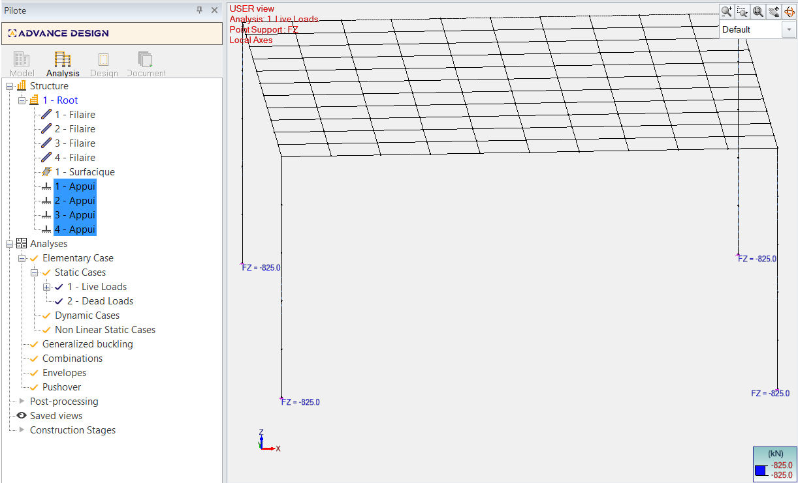
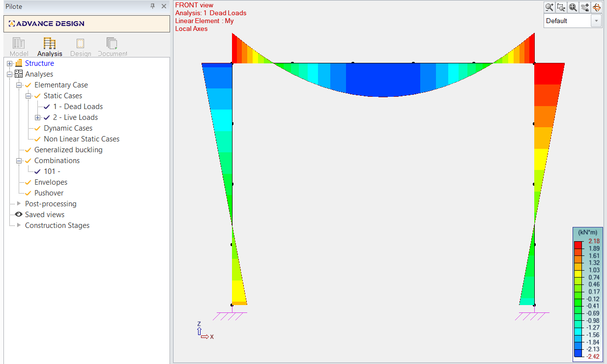
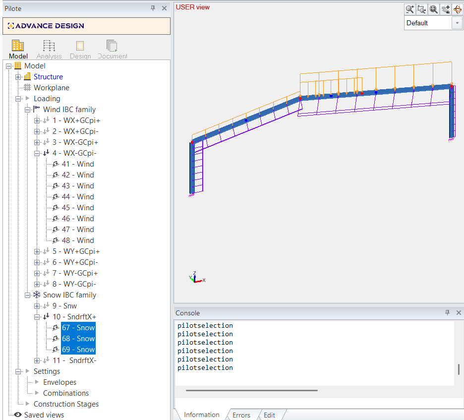
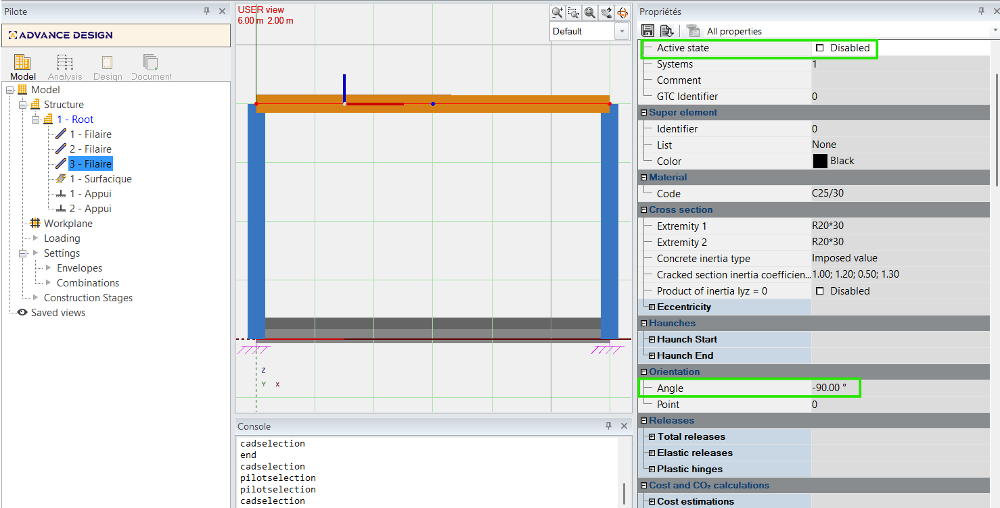

# Test.API.Client — Advance Design API Sample

A minimal **C# .NET 8 console application** showing how to drive [Advance Design](https://www.graitec.com/advance-design/) programmatically through its HTTP API.

The samples creates strucutrees in new models, call climatic loads autogeneration, creates analysis and retrives results — all without opening the Advance Design UI.

---

## Available Samples

The project includes several samples demonstrating different API capabilities. Select a sample from the menu when you run the application.

### 1. Analysis results: 4-column slab support Fz verification (Europe, 1% tol)

**File:** `PortalFrame4ColumnsSlabSupportFzVerification.cs`

Creates a Europe-localized model with 4 columns (C25/30, R20*30, 5m height), a 10m × 11m planar slab (0.20m thick) at Z=5m, 4 rigid point supports at column bases, a live load family with one planar load (Fz=-30 kN/m²), and a dead load family. Runs analysis and verifies that the sum of support Fz reactions on the live load case matches the applied slab load (Fz × area) within 1% tolerance.



### 2. Analysis results: Imposed displacement structure with result verification

**File:** `ImposedDisplacementStructureWithResults.cs`

Creates a 3-element portal frame (2 columns + 1 beam) with an imposed displacement of -3cm DZ at one support. Runs linear analysis and verifies that the displacement on the column at the imposed location is ~3cm.


### 3. Analysis results: Portal frame 3 elements analysis verification (5% tol)

**File:** `PortalFrame3ElementsAnalysisVerification.cs`

Creates a portal frame with 3 linear elements (C25/30, R20/30), 2 rigid supports, dead and live load families with punctual loads. Runs analysis with ULS combination and verifies support reaction forces, beam force diagrams (Fz, My), displacement (Dz), and stress (SxxMax) within 5% tolerance.




### 4. Analysis results: Slab with rigid linear supports, analysis and all results on slab

**File:** `PlanarSlabRigidLinearSupportsFrance.cs`

Creates a planar shell slab (0.15m thick, 42m²) with 2 rigid linear supports, a live load case with planar load (Fz=-12 kN/m²), and a dead load case. Runs analysis with ULS combination and displays all results (Displacement, Forces, Stresses) for the planar element.


### 5. Climatic: 3D building with wind (EN 1991-1-4) and snow (EN 1991-1-3) auto generation (France)

**File:** `WindSnow3DBuildingAutoGeneration.cs`

Creates a 3D building structure (columns + slabs forming a hall) with France localization. Sets up wind (EN 1991-1-4) and snow (EN 1991-1-3) load case families and triggers automatic climatic load generation according to Eurocode norms.


### 6. Climatic: Portal 2D Structure and IBC (ASCE 7-22) Climatic Generation

**File:** `Portal2DStructureAndClimaticGeneration.cs`

Creates a 2D steel portal frame with IBC (ASCE 7-22) wind and snow load case families. Demonstrates automatic climatic load generation for US building codes with multiple wind directions and snow load cases.




### 7. Climatic: Portal 2D Structure and IBC (ASCE 7-22) Climatic Generation (multiple roof elements)

**File:** `Portal2DStructureAndClimaticGeneration.cs`

Extended version of the previous sample with multiple roof elements to demonstrate climatic load distribution across complex roof geometries.

### 8. Intentional error testing: Structure with intentional material error

**File:** `StructureWithIntentionalMaterialError.cs`

Demonstrates error handling by intentionally creating a structure with an invalid material reference, showing how to catch and handle API errors gracefully.

### 9. Properties setting and model management: Custom properties set and verification after reopen

**File:** `CustomPropertiesVerificationOnReopen.cs`

Creates a structure, sets custom properties on elements, saves the project, reopens it, and verifies that the custom properties were persisted correctly.



### 10. 3 story slabs on columns

**File:** `BigTestSampleWMostAPIFunctions.cs`

Creates a multi-story structure with slabs on columns, demonstrating complex model assembly with multiple levels.

### 11. Big sample testing most API functions

**File:** `BigTestSampleWMostAPIFunctions.cs`

Comprehensive sample exercising most of the API surface: materials, sections, linear and planar elements, supports, loads, load cases, combinations, analysis, and result retrieval.

---

## Prerequisites

| Requirement | Notes |
|-------------|-------|
| **Advance Design 2027** installed and redistributables | The API server (`AD.API.Srv.exe`) ships with the product. At least build 2027.0.22035). Microsoft Access Database Engine 2016 Redistributable recommended https://www.microsoft.com/en-us/download/details.aspx?id=54920|
| **.NET 8 SDK** | `dotnet --version` must be ≥ 8.0. |
| API configuration | Defaults are provided in `Properties/launchSettings.json`; see the table below. |

---

## Dependency

This project references `AD.API.Client.dll` from the Advance Design binary path (`AD_API_SERVER_BINARY_PATH`). The assembly contains the generated HTTP client and session manager and is referenced directly rather than through a NuGet package.

---

### Environment Variables

The project ships with a `Properties/launchSettings.json` file that sets **default values** for all three variables. Visual Studio and `dotnet run` apply these values to the launched application.

The build also reads `AD_API_SERVER_BINARY_PATH` from the `Test.API.Client` profile to locate `AD.API.Client.dll`. A nonempty launch-profile value has precedence. If it is missing or empty, the build uses the value inherited from the `dotnet` process or supplied with the `AD_API_SERVER_BINARY_PATH` MSBuild property.

Change the primary value in `Properties/launchSettings.json`. To use an environment or command-line fallback instead, remove that variable from the launch profile or set it to an empty string, then use one of these options:

```powershell
$env:AD_API_SERVER_BINARY_PATH = "C:\Program Files\Graitec\Advance Design\2027\Bin\"
dotnet build v2027\Samples\Test.API.Client\Test.API.Client-public.csproj

dotnet build v2027\Samples\Test.API.Client\Test.API.Client-public.csproj `
    '-p:AD_API_SERVER_BINARY_PATH=C:\Program Files\Graitec\Advance Design\2027\Bin\'
```

To persist the variables for future terminals and IDE sessions, configure them in **Settings → System → Advanced system settings → Environment Variables → User variables**, or run:

```powershell
[System.Environment]::SetEnvironmentVariable(
    "AD_API_SERVER_BINARY_PATH",
    "C:\Program Files\Graitec\Advance Design\2027\Bin\",
    "User")

[System.Environment]::SetEnvironmentVariable(
    "AD_MODELS_PATH",
    "C:\ProgramData\Graitec\Advance Design\2027\Projects\",
    "User")

[System.Environment]::SetEnvironmentVariable(
    "AD_API_SERVER_URL",
    "http://localhost:52000/",
    "User")
```

| Variable | Default value | Description |
|----------|---------------|-------------|
| `AD_API_SERVER_BINARY_PATH` | `C:\Program Files\Graitec\Advance Design\2027\Bin\` | Folder that contains `AD.API.Srv.exe`. The client will start the server automatically if it is not already running. |
| `AD_MODELS_PATH` | `C:\ProgramData\Graitec\Advance Design\2027\Projects\` | Directory where new project files are created. |
| `AD_API_SERVER_URL` | `http://localhost:52000/` | Base URL of a **already-running** API server. If the server is not reachable at this URL the client starts a new one from `AD_API_SERVER_BINARY_PATH`. |

> **Developer tip:** Point `AD_API_SERVER_BINARY_PATH` to your local build output (e.g. `C:\Sources\ADrepos\DevAD\ServerX64\bin\`) to test against a freshly compiled server.

---

## Build & Run

```powershell
# from the repository root
dotnet build v2027\Samples\Test.API.Client\Test.API.Client-public.csproj

dotnet run --project v2027\Samples\Test.API.Client\Test.API.Client-public.csproj
```

Or open `v2027\Samples\Test.API.Client\Test.API.Client.sln` in Visual Studio 2022, set `Test.API.Client` as the startup project, and press **F5**.

The console will print per-step results. Press **Enter** at the end to close.

---

## Project Structure

```
Test.API.Client/
├── Program.cs                                   # Entry point + shared helpers
├── Portal2DStructureAndClimaticGeneration.cs    # Sample scenario (see below)
└── Properties/
    └── launchSettings.json                      # Default environment variables
```

### `Program.cs` — Entry point

Key sections:

| Section | What it does |
|---------|--------------|
| `GetEnvironmentVariable` helper | Checks Process → User → Machine scopes in order. |
| Assembly resolver | Registered at startup; probes `AD_API_SERVER_BINARY_PATH` for managed assemblies that the CLR cannot find through default probing. |
| Server auto-start | If the API server is not reachable at `AD_API_SERVER_URL`, `CSessionManager.StartNewSessionAsync` launches `AD.API.Srv.exe` and waits up to 10 s. |
| Sample dispatch | Calls one of the `Sample_*` methods. Uncomment / add calls to run other scenarios. |
| Diagnostic helpers | `PrintResultDetails`, `DumpError`, `DiagText` — reuse these in your own samples. |

### `Portal2DStructureAndClimaticGeneration.cs` — Sample scenario

Demonstrates the **full create → analyse → read-back** loop:

1. `NewProject` — create a project in the models folder.
2. `CreateMaterial` — S235 steel + C25/30 concrete.
3. `CreateSection` — IPE400 catalogue section.
4. `CreateElement` (×4) — columns and roof beam forming a portal frame with `ClimaticLE2D = true`.
5. `CreateElement` (×2) — rigid punctual supports at the column bases.
6. `CreateLoadCaseFamily` + `CreateLoadCase` — IBC wind & snow families with multiple wind-direction and snow load cases.
7. `ClimaticAutoGeneration` — auto-generates loads from the climatic definition.
8. `GetElements` + `GetElement` — reads back generated loads and prints them.

---

## How to Add Your Own Sample

1. Add a new `partial class Program` file, e.g. `MySample.cs`:

```csharp
namespace Test.API.Client
{
    internal partial class Program
    {
        static void Sample_MySample(AD.API.Client.AD_Client client)
        {
            // your code here
            var resp = client.NewProject("C:\\Temp\\MySample\\", new Environments
            {
                Language = AD.API.Client.Language_Code.ELanguageEnglish,
                LogVerbosity = AD.API.Client.LogVerboseLevel.Errors
            });
            PrintResultDetails(resp.Details, LogVerboseLevel.Errors, "New project");
            // ...
            client.CloseProject();
        }
    }
}
```

2. In `Program.cs`, inside `thread1`'s body, replace (or add) the sample call:

```csharp
Sample_MySample(client);
```

3. Run the project — your sample executes and prints results to the console.

---

## API Response Pattern

Every `AD_Client` method returns an `ApiResponse` wrapper. Always check:

```csharp
var resp = client.CreateMaterial(new Material { Name = "S235" });

if (!resp.Details.Success || resp.Details.HasErrors)
{
    // resp.Details.Diagnostics contains structured error messages
    PrintResultDetails(resp.Details, LogVerboseLevel.Errors, "CreateMaterial");
    return;
}

EID materialId = resp.Data; // the created object's ID
```

| Property | Type | Meaning |
|----------|------|---------|
| `Details.Success` | `bool` | `true` when no error-level diagnostics occurred |
| `Details.HasErrors` | `bool` | `true` if any error diagnostic is present |
| `Details.HasWarnings` | `bool` | `true` if any warning is present |
| `Details.Diagnostics` | `ICollection<DiagnosticEntry>` | Structured list of messages |
| `Data` | varies | The payload (`EID`, list, `bool`, etc.) |

---

## Related Projects

| Project | Description |
|---------|-------------|
| `AD.API.Client` | Generated HTTP client + session manager. Referenced as a project dependency. |
| `AD.API.Srv` | The ASP.NET server that hosts the Advance Design engine. |
| `Test.API.Client.UnitTests` | Integration tests that exercise the same API surface as this sample. |
